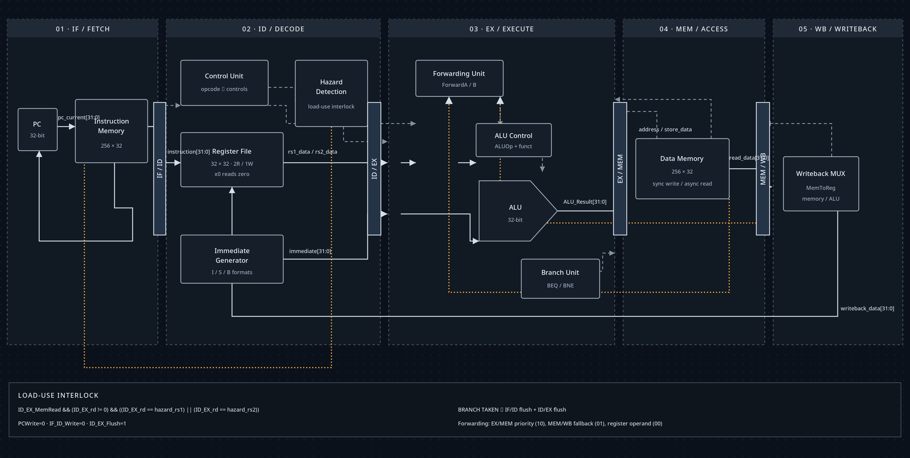

<div align="center">

# ⚡ 5-Stage Pipelined RISC Processor

### Design and Verification of a 32-bit Pipelined RISC Processor using Verilog HDL

**COMPUTER ARCHITECTURE · RTL DESIGN · PIPELINE MICROARCHITECTURE · HARDWARE VERIFICATION**

`INSTRUCTION FETCH → DECODE → EXECUTE → MEMORY → WRITE BACK`

[**Explore the Interactive Processor Datapath →**](docs/processor-datapath.html)

</div>

---

# 01. Project Overview

This project presents the design, RTL implementation and simulation-based verification of a **32-bit, five-stage pipelined RISC processor** using Verilog Hardware Description Language.

The processor implements a modular microarchitecture based on the conventional five-stage instruction pipeline. Its datapath is divided into independent execution stages, with dedicated pipeline registers preserving instruction state and control information across clock cycles.

The architecture integrates instruction decoding, register-file access, arithmetic and logical execution, memory interfacing, data forwarding, hazard detection and branch resolution.

Particular emphasis is placed on understanding how instruction dependencies are resolved within a pipelined datapath and how control logic coordinates the execution of multiple instructions simultaneously.

The complete RTL hierarchy is accompanied by individual module-level testbenches, an integrated processor testbench and waveform traces for examining internal signal transitions.

---

# 🏗️ Processor Architecture

The processor implements a classic five-stage pipeline architecture,
integrating instruction decoding, execution, memory access,
data forwarding and hazard management.

<p align="center">
  
</p>

<p align="center">
  <b>Fig. 1 — Complete Processor Datapath and Control Architecture</b>
</p>

---

### Core Design Characteristics

- 32-bit datapath and instruction architecture.
- Five-stage instruction execution pipeline.
- Modular RTL implementation.
- Centralized instruction control and decoding.
- Dedicated arithmetic and logical execution unit.
- Two-path data forwarding architecture.
- Load-use hazard detection and pipeline interlocking.
- EX-stage branch resolution and pipeline flushing.
- Integrated instruction and data memory.
- Simulation-based functional verification.

---

# 02. Architectural Specification

| Parameter | Specification |
|---|---|
| Processor architecture | 32-bit RISC-style |
| Instruction width | 32 bits |
| Datapath width | 32 bits |
| Register address width | 5 bits |
| General-purpose registers | 32 × 32-bit |
| Pipeline depth | 5 stages |
| Pipeline registers | 4 |
| Execution stages | IF, ID, EX, MEM, WB |
| ALU operations | 5 |
| Immediate formats | I-type, S-type, B-type |
| Instruction memory | 256 × 32-bit |
| Data memory | 256 × 32-bit |
| Register-file read | Asynchronous |
| Register-file write | Synchronous |
| Memory read | Asynchronous |
| Memory write | Synchronous |
| Data forwarding | EX/MEM and MEM/WB |
| Hazard management | Forwarding and load-use interlock |
| Branch resolution | EX stage |
| RTL language | Verilog HDL |

# 03. Five-Stage Pipeline Architecture

The processor implements a classic five-stage pipeline in which different instructions occupy different execution stages during the same clock cycle.

This organization separates instruction processing into smaller functional stages, allowing instruction throughput to improve through overlapping execution.

## 3.1 Instruction Fetch (IF)

**Primary function:** Instruction retrieval and program-counter management.

Hardware modules:

- `program_counter`
- `instruction_memory`
- `next_pc_selector`

The Program Counter maintains the address of the current instruction.

For sequential execution, the next instruction address is calculated as:

\[
PC_{next}=PC_{current}+4
\]

The instruction memory receives the current program counter and provides the corresponding 32-bit instruction.

The next-PC selection logic determines the address supplied to the Program Counter based on the current control-flow condition.

\[
PC_{next}=
\begin{cases}
BranchTarget & BranchTaken\\
PC_{current}+4 & Otherwise
\end{cases}
\]

The PC update is coordinated with the hazard detection logic through the `PCWrite` control signal.

## 3.2 Instruction Decode (ID)

**Primary function:** Instruction interpretation, register access and control generation.

Hardware modules:

- `control_unit`
- `immediate_generator`
- `register_file`
- `hazard_detection`

The instruction decoder extracts the fields required for instruction execution.

| Field | Bit Range | Width |
|---|---|---:|
| Opcode | `[6:0]` | 7 bits |
| Destination register | `[11:7]` | 5 bits |
| Function 3 | `[14:12]` | 3 bits |
| Source register 1 | `[19:15]` | 5 bits |
| Source register 2 | `[24:20]` | 5 bits |
| Function 7 | `[31:25]` | 7 bits |

The control unit interprets the opcode and generates the associated execution controls.

The register file provides two asynchronous read ports, while the immediate generator reconstructs the immediate value according to the instruction format.

The decoded operands, destination identifier, immediate and control information are transferred into the ID/EX pipeline register.

## 3.3 Execute (EX)

**Primary function:** Arithmetic execution, operand forwarding and branch resolution.

Hardware modules:

- `alu`
- `alu_control`
- `forwarding_unit`
- `branch_unit`

The EX stage receives the decoded operands and selects the appropriate input values through forwarding multiplexers.

The ALU performs the selected arithmetic or logical operation.

The forwarding unit resolves dependencies by examining destination-register information from later pipeline stages.

The branch unit evaluates conditional branch instructions using forwarded operands.

The branch target is calculated using:

\[
BranchTarget=ID\_EX\_PC+Immediate
\]

Branch decisions are resolved in the EX stage, allowing the next-PC selection logic to redirect instruction fetching when required.

## 3.4 Memory Access (MEM)

**Primary function:** Data memory interfacing.

Hardware module:

- `data_memory`

The effective memory address is calculated in EX and carried into EX/MEM.

\[
EffectiveAddress=BaseRegister+Immediate
\]

For store instructions, the source data is transferred through the pipeline register into the memory write interface.

For load instructions, the memory read result is passed towards the MEM/WB pipeline register.

The data memory contains 256 entries, each 32 bits wide, with word addressing based on:

\[
MemoryIndex=Address[9:2]
\]

## 3.5 Write Back (WB)

**Primary function:** Register-file result commitment.

The MEM/WB pipeline register carries the destination register, ALU result, memory data and associated write-back control signals.

The write-back multiplexer selects the value to be written into the register file.

\[
WBData=
\begin{cases}
MemoryData & MemToReg=1\\
ALUResult & MemToReg=0
\end{cases}
\]

The selected value is written into the destination register when `RegWrite` is asserted.

---

# 04. Pipeline Register Architecture

The processor uses four sequential pipeline registers to maintain instruction state between execution stages.

| Register | Pipeline Boundary | Principal Information |
|---|---|---|
| IF/ID | IF → ID | Instruction and program counter |
| ID/EX | ID → EX | Operands, immediate, PC, register identifiers and control signals |
| EX/MEM | EX → MEM | ALU result, store data, destination register and memory controls |
| MEM/WB | MEM → WB | Memory data, ALU result, destination register and write-back controls |

### Pipeline State Management

Each pipeline register is synchronized to the processor clock and supports reset behaviour.

The IF/ID register supports instruction holding during stalls.

The ID/EX register supports flushing to insert bubbles into the execution pipeline.

The EX/MEM and MEM/WB registers transfer execution and memory information towards the final write-back stage.

This separation ensures that instruction data and associated control signals remain synchronized throughout pipeline execution.

---

# 05. Arithmetic Logic Unit

**RTL:** `rtl/alu/alu.v`

The Arithmetic Logic Unit is responsible for executing arithmetic and bitwise logical operations.

### Operation Table

| ALU Control | Operation | Function |
|---|---|---|
| `000` | ADD | Addition |
| `001` | SUB | Subtraction |
| `010` | AND | Bitwise AND |
| `011` | OR | Bitwise OR |
| `100` | XOR | Bitwise XOR |

The ALU operates on two 32-bit operands and produces a 32-bit result.

It also generates a zero indication based on the resulting value:

\[
Zero=(Result=0)
\]

The ALU is implemented as an independent combinational module, allowing the operation-selection logic and arithmetic datapath to remain separate.

# 06. Control Unit and Instruction Decoding

**RTL:** `rtl/control_unit/control_unit.v`

The control unit generates the processor's primary control signals based on the instruction opcode.

### Control Signal Description

| Signal | Function |
|---|---|
| `RegWrite` | Enables destination-register write-back |
| `ALUSrc` | Selects the second ALU operand |
| `MemRead` | Controls memory read operation |
| `MemWrite` | Controls memory write operation |
| `MemToReg` | Selects memory data for write-back |
| `Branch` | Enables conditional branch processing |
| `ALUOp` | Determines ALU operation decoding |

### Control Truth Table

| Instruction | Opcode | RegWrite | ALUSrc | MemRead | MemWrite | MemToReg | Branch | ALUOp |
|---|---|---:|---:|---:|---:|---:|---:|---|
| R-type | `0110011` | 1 | 0 | 0 | 0 | 0 | 0 | `10` |
| ADDI | `0010011` | 1 | 1 | 0 | 0 | 0 | 0 | `00` |
| Load | `0000011` | 1 | 1 | 1 | 0 | 1 | 0 | `00` |
| Store | `0100011` | 0 | 1 | 0 | 1 | 0 | 0 | `00` |
| Branch | `1100011` | 0 | 0 | 0 | 0 | 0 | 1 | `01` |

### ALU Control

**RTL:** `rtl/alu_control/alu_control.v`

The ALU control module translates the instruction function fields and ALU operation class into the three-bit ALU selection code.

This separates instruction classification from the internal implementation of the ALU.

# 07. Instruction Set

The processor executes the following instruction subset.

| Category | Instruction | Operation |
|---|---|---|
| Arithmetic | ADD | Register-register addition |
| Arithmetic | SUB | Register-register subtraction |
| Immediate arithmetic | ADDI | Register-immediate addition |
| Logical | AND | Bitwise AND |
| Logical | OR | Bitwise OR |
| Logical | XOR | Bitwise XOR |
| Memory | LW | Load word |
| Memory | SW | Store word |
| Branch | BEQ | Branch if equal |
| Branch | BNE | Branch if not equal |

### Instruction Encoding

The instruction decoder extracts the opcode, register identifiers and function fields directly from the 32-bit instruction word.

The immediate generator supports:

| Format | Immediate Construction | Associated Instructions |
|---|---|---|
| I-type | `instruction[31:20]` with sign extension | ADDI, LW |
| S-type | `instruction[31:25]` concatenated with `instruction[11:7]` | SW |
| B-type | Reconstructed branch offset with sign extension | BEQ, BNE |

For B-type instructions, the immediate is assembled from non-contiguous instruction fields and includes the implicit least-significant zero bit.

# 08. Data Forwarding Architecture

**RTL:** `rtl/forwarding_unit/forwarding_unit.v`

Data forwarding is implemented to resolve read-after-write dependencies without requiring every dependent instruction to wait for register-file write-back.

The forwarding unit compares source-register identifiers from ID/EX against destination-register identifiers in EX/MEM and MEM/WB.

### Forwarding Paths

1. EX/MEM → EX
2. MEM/WB → EX

### Forwarding Selection

| Condition | Selection | Source |
|---|---|---|
| EX/MEM destination matches source | `10` | EX/MEM ALU result |
| MEM/WB destination matches source | `01` | Write-back data |
| No dependency detected | `00` | ID/EX operand |

EX/MEM has priority over MEM/WB.

The forwarding decisions are independently generated for the two execution operands.

### Forwarding Logic

For the first source operand:

\[
ForwardA=
\begin{cases}
10 & EXMEM.rd=IDEX.rs1 \land EXMEM.RegWrite\\
01 & MEMWB.rd=IDEX.rs1 \land MEMWB.RegWrite\\
00 & Otherwise
\end{cases}
\]

For the second source operand:

\[
ForwardB=
\begin{cases}
10 & EXMEM.rd=IDEX.rs2 \land EXMEM.RegWrite\\
01 & MEMWB.rd=IDEX.rs2 \land MEMWB.RegWrite\\
00 & Otherwise
\end{cases}
\]

The comparisons also qualify destination registers against x0.

The MEM/WB forwarding path uses the final write-back data rather than only the ALU result.

This allows the forwarding network to select the value actually being committed to the register file.

---

# 09. Hazard Detection and Pipeline Interlocking

**RTL:** `rtl/hazard_detection/hazard_detection.v`

The hazard detection unit identifies load-use dependencies and coordinates pipeline control to preserve correct instruction execution.

### Load-Use Dependency

A load-use dependency occurs when an instruction requires a register value that is currently being retrieved from data memory.

The detection condition is:

\[
LoadUse=
ID\_EX.MemRead
\land(ID\_EX.rd\neq0)
\land
\left[
(ID\_EX.rd=IF\_ID.rs1)
\lor
(ID\_EX.rd=IF\_ID.rs2)
\right]
\]

### Interlock Response

When a dependency is detected:

| Control | Action |
|---|---|
| PCWrite | Disabled |
| IF_ID_Write | Disabled |
| ID_EX_Flush | Asserted |

The Program Counter and IF/ID register retain their previous state, while ID/EX receives a bubble.

This introduces the required separation between the memory-read instruction and its dependent instruction.

The processor also qualifies source-register identifiers according to instruction type before performing hazard comparisons.

This prevents unused instruction fields from being interpreted as valid register dependencies.

---

# 10. Branch Resolution and Control-Flow Management

**RTL:** `rtl/branch_unit/branch_unit.v`

The branch unit evaluates branch conditions using operands supplied by the forwarding network.

### Supported Conditions

| Instruction | Condition |
|---|---|
| BEQ | `rs1 == rs2` |
| BNE | `rs1 != rs2` |

The branch target is calculated as:

\[
Target=ID\_EX\_PC+Immediate
\]

When a branch is taken, the next-PC selector redirects the Program Counter to the calculated target.

The processor simultaneously flushes the IF/ID and ID/EX pipeline registers.

This removes instructions fetched along the sequential execution path after a taken branch.

Branch resolution in EX allows the branch unit to use the same forwarded operands available to the execution datapath.

---

# 11. Memory Subsystem

## 11.1 Instruction Memory

**RTL:** `rtl/instruction_memory/instruction_memory.v`

| Parameter | Value |
|---|---|
| Depth | 256 words |
| Width | 32 bits |
| Capacity | 8192 bits |
| Read mechanism | Asynchronous |
| Address index | `PC[9:2]` |

The instruction memory contains the processor's initialized demonstration program.

Instruction retrieval is based on the word-aligned program-counter address.

## 11.2 Data Memory

**RTL:** `rtl/data_memory/data_memory.v`

| Parameter | Value |
|---|---|
| Depth | 256 words |
| Width | 32 bits |
| Capacity | 8192 bits / 1 KB |
| Address index | `Address[9:2]` |
| Read mechanism | Asynchronous |
| Write mechanism | Synchronous |

The data memory is integrated with the processor's EX/MEM and MEM/WB pipeline stages.

The ALU calculates the effective address, while the memory interface receives the address, write data and memory control signals.

# 12. Integrated Demonstration Program

The instruction memory contains a demonstration program designed to exercise the processor's integrated datapath.

| Address | Machine Code | Instruction | Purpose |
|---:|---|---|---|
| 0 | `00A00093` | `ADDI x1, x0, 10` | Register initialization |
| 1 | `01400113` | `ADDI x2, x0, 20` | Register initialization |
| 2 | `002081B3` | `ADD x3, x1, x2` | Arithmetic execution |
| 3 | `40208233` | `SUB x4, x1, x2` | Subtraction execution |
| 4 | `00302023` | `SW x3, 0(x0)` | Memory write |
| 5 | `00002183` | `LW x3, 0(x0)` | Memory read |
| 6 | `001182B3` | `ADD x5, x3, x1` | Load-dependent execution |
| 7 | `00108463` | `BEQ x1, x1, 8` | Conditional branch |
| 8 | `06300093` | `ADDI x1, x0, 99` | Sequential-path instruction |
| 9 | `04D00393` | `ADDI x7, x0, 77` | Branch-target execution |

### Expected Results

| Register / Memory | Result |
|---|---:|
| x1 | 10 |
| x2 | 20 |
| x3 | 30 |
| x4 | -10 |
| x5 | 40 |
| x7 | 77 |
| Data Memory[0] | 30 |

The program exercises arithmetic operations, memory access, forwarding, load-use interlocking and branch flushing within a single integrated execution sequence.

---

# 13. Top-Level Processor Integration

**RTL:** `rtl/processor.v`

The processor module integrates the complete datapath and pipeline control architecture.

### External Interface

| Signal | Direction | Width | Description |
|---|---|---:|---|
| `clk` | Input | 1 | Processor clock |
| `reset` | Input | 1 | Active-high reset |
| `pc_debug` | Output | 32 | Program-counter observation |
| `result_debug` | Output | 32 | Write-back data observation |
| `branch_debug` | Output | 1 | Branch activity |
| `stall_debug` | Output | 1 | Pipeline stall indication |

### Integrated Hardware

The top-level processor connects:

- Program Counter
- Instruction Memory
- IF/ID Pipeline Register
- Control Unit
- Immediate Generator
- Register File
- Hazard Detection Unit
- ID/EX Pipeline Register
- Forwarding Unit
- ALU Control
- Arithmetic Logic Unit
- Branch Unit
- Next-PC Selector
- EX/MEM Pipeline Register
- Data Memory
- MEM/WB Pipeline Register

The architecture separates combinational execution logic from sequential pipeline state, maintaining a modular and readable RTL hierarchy.

# 14. Verification and Simulation

The project includes module-level testbenches and an integrated processor testbench.

### Verification Coverage

| Verification Target | Testbench |
|---|---|
| ALU | `alu_tb.v` |
| ALU Control | `alu_control_tb.v` |
| Branch Unit | `branch_unit_tb.v` |
| Control Unit | `control_unit_tb.v` |
| Data Memory | `data_memory_tb.v` |
| Forwarding Unit | `forwarding_unit_tb.v` |
| Hazard Detection | `hazard_detection_tb.v` |
| Immediate Generator | `immediate_generator_tb.v` |
| Instruction Memory | `instruction_memory_tb.v` |
| Next-PC Selector | `next_pc_selector_tb.v` |
| IF/ID Register | `if_id_tb.v` |
| ID/EX Register | `id_ex_tb.v` |
| EX/MEM Register | `ex_mem_tb.v` |
| MEM/WB Register | `mem_wb_tb.v` |
| Program Counter | `program_counter_tb.v` |
| Register File | `register_file_tb.v` |
| Integrated Processor | `processor_tb.v` |

### Processor-Level Verification

The integrated testbench generates a clock, applies reset and executes the initialized instruction sequence.

The verification process observes:

- Register-file updates.
- Data-memory operations.
- Load-use stall events.
- Branch execution.
- Pipeline control behaviour.
- Selected final register values.

The directed processor test checks the expected results of the demonstration program and confirms the occurrence of the intended stall and branch events.

### Simulation Environment

| Tool | Purpose |
|---|---|
| Icarus Verilog | RTL compilation and simulation |
| GTKWave | Signal and waveform inspection |
| VCD | Simulation trace format |

### Running the Processor Testbench

```bash
mkdir -p simulation/waveforms

iverilog -g2012 -o processor_sim \
  $(find rtl -name "*.v") \
  testbench/processor/processor_tb.v

vvp processor_sim
```

### Waveform Inspection

```bash
gtkwave simulation/waveforms/processor.vcd
```

The VCD traces allow inspection of clock transitions, pipeline-register behaviour, forwarding selections, stall signals, branch decisions and datapath values.

---

# 15. RTL Module Hierarchy

```text
processor
│
├── program_counter
│
├── instruction_memory
│
├── if_id
│
├── control_unit
│
├── immediate_generator
│
├── register_file
│
├── hazard_detection
│
├── id_ex
│
├── forwarding_unit
│
├── alu_control
│
├── alu
│
├── branch_unit
│
├── next_pc_selector
│
├── ex_mem
│
├── data_memory
│
└── mem_wb
```

The hierarchy follows a modular RTL design methodology in which individual hardware functions are implemented independently and integrated through the processor top module.

# 16. FPGA Development Platform

The project includes an FPGA top-level wrapper:

`rtl/fpga_top.v`

The wrapper connects the processor to a six-bit LED output interface.

| LED | Function |
|---|---|
| LED[3:0] | Selected program-counter bits |
| LED[4] | Branch activity |
| LED[5] | Pipeline stall activity |

### Target Platform

| Component | Technology |
|---|---|
| FPGA board | Tang Nano 9K |
| FPGA toolchain | Gowin IDE |
| RTL language | Verilog HDL |
| Simulation | Icarus Verilog |
| Waveform analysis | GTKWave |

The top-level wrapper provides an observable hardware interface for processor execution and pipeline activity.

# 17. Repository Structure

```text
5-Stage-Pipelined-RISC-Processor/
│
├── rtl/
│   ├── alu/
│   ├── alu_control/
│   ├── branch_unit/
│   ├── control_unit/
│   ├── data_memory/
│   ├── forwarding_unit/
│   ├── hazard_detection/
│   ├── immediate_generator/
│   ├── instruction_memory/
│   ├── next_pc_selector/
│   ├── pipeline_registers/
│   │   ├── if_id/
│   │   ├── id_ex/
│   │   ├── ex_mem/
│   │   └── mem_wb/
│   ├── program_counter/
│   ├── register_file/
│   ├── processor.v
│   └── fpga_top.v
│
├── testbench/
│   ├── alu/
│   ├── alu_control/
│   ├── branch_unit/
│   ├── control_unit/
│   ├── data_memory/
│   ├── forwarding_unit/
│   ├── hazard_detection/
│   ├── immediate_generator/
│   ├── instruction_memory/
│   ├── next_pc_selector/
│   ├── pipeline_registers/
│   ├── processor/
│   ├── program_counter/
│   └── register_file/
│
├── simulation/
│   └── waveforms/
│
├── docs/
│   └── processor-datapath.html
│
├── README.md
└── .gitignore
```

# 18. Engineering Concepts Demonstrated

The implementation brings together several fundamental concepts in digital systems and processor microarchitecture.

| Concept | Application |
|---|---|
| Instruction pipelining | Overlapping execution across five stages |
| Datapath design | Coordinating data movement between hardware units |
| Control decoding | Generating execution signals from instruction fields |
| Register-file architecture | Multiport operand access and synchronous write-back |
| ALU design | Combinational arithmetic and logical execution |
| RAW dependency handling | Forwarding between pipeline stages |
| Pipeline interlocking | Load-use stall and bubble insertion |
| Control-flow management | Branch evaluation and pipeline flushing |
| Sequential logic | Pipeline registers and state management |
| RTL verification | Module-level and processor-level simulation |
| Waveform analysis | Inspecting internal signal behaviour |
| FPGA-oriented design | Integrating a processor with a hardware development target |

---

# 19. Author

<div align="center">

### Mahdiya Rifqua M.

**B.Tech — Computer Science and Medical Engineering**

Interested in:

**RTL Design · Digital Systems · Computer Architecture · FPGA Engineering · Hardware Microarchitecture**

</div>

---

<div align="center">

### PROJECT COMPLETED

**32-bit Five-Stage Pipelined RISC Processor**

*Designed, implemented and verified at RTL level.*

</div>
